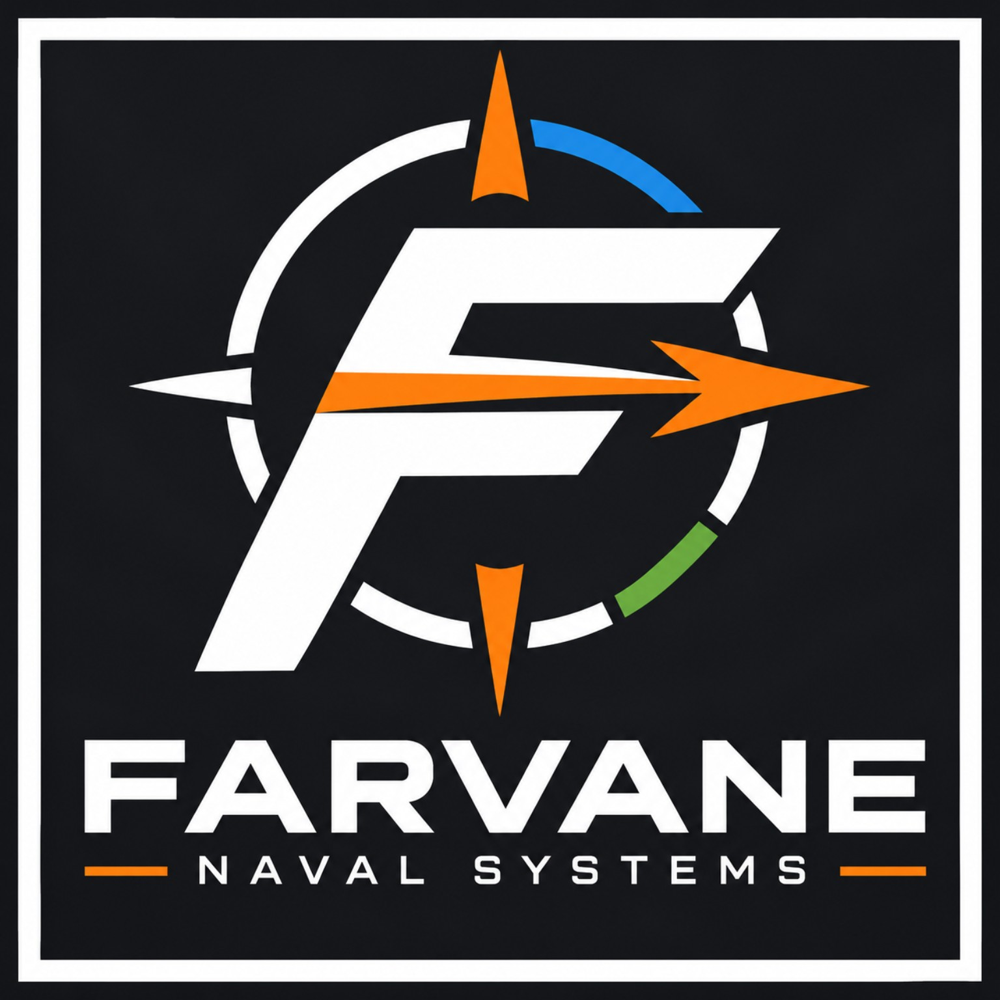

# Farvane Naval Systems

<p align="center">
  
</p>

<p align="center"><strong>Built Where the Map Ends.</strong></p>

Farvane Naval Systems (FNS) is a fan-created **Space Engineers 2** shipbuilding, modding, and worldbuilding project. In its fictional continuity, FNS is a wholly owned subsidiary of **Outer Planets Consolidation (OPC)** operating as an advance naval-engineering expedition in the Almagest system.

> [!IMPORTANT]
> FNS is an independent fan project. It is not affiliated with or endorsed by Keen Software House, Foltast, Dercaixr, or the creators of Outer Planets Consolidation. Space Engineers and Space Engineers 2 are properties of Keen Software House. OPC was created by Foltast and Dercaixr. FNS references OPC designs as creative inspiration; it does not claim permission to redistribute original OPC assets.

This document is both the public organization profile and the initial common standard for FNS projects. It separates out-of-character project practice from in-universe continuity and labels proposals honestly.

## Contents

- [OOC — About the Project](#ooc--about-the-project)
- [Reference Foundation](#reference-foundation)
- [IC — Farvane Naval Systems](#ic--farvane-naval-systems)
- [Historical Continuity and Almagest Operations](#historical-continuity-and-almagest-operations)
- [Mission and Corporate Structure](#mission-and-corporate-structure)
- [Design Philosophy](#design-philosophy)
- [Visual Design Language](#visual-design-language)
- [Official Color Palette](#official-color-palette)
- [Corporate Insignia and Hull Markings](#corporate-insignia-and-hull-markings)
- [Fleet Classification and Naming](#fleet-classification-and-naming)
- [Technology Development Programs](#technology-development-programs)
- [Mods and Blueprints](#mods-and-blueprints)
- [Engineering and Development Standards](#engineering-and-development-standards)
- [Releases and Versioning](#releases-and-versioning)
- [Canon and Lore Management](#canon-and-lore-management)
- [Contributions and AI-Assisted Development](#contributions-and-ai-assisted-development)
- [Licensing, Credits, and References](#licensing-credits-and-references)
- [Roadmap](#roadmap)

---

## OOC — About the Project

### Project brief

| Field | Standard |
|---|---|
| Name | Farvane Naval Systems |
| Abbreviation | FNS |
| Fictional parent | Outer Planets Consolidation |
| Setting | Almagest system, Space Engineers 2 |
| Focus | Warships, advanced military technology, naval engineering, and defense R&D |
| Tagline | **Built Where the Map Ends.** |

FNS exists to develop an interconnected, maintainable library of:

- military spacecraft blueprints and experimental warships;
- weapons, defensive systems, and shipboard technology mods;
- shipboard electronics, sensors, and functional blocks;
- research worlds, test fixtures, and construction environments;
- engineering notes, release documentation, and coherent fictional lore.

FNS is not a general-purpose civilian manufacturer. Civilian and industrial assets should normally support naval construction, expeditionary logistics, research, repair, testing, or fleet operations.

### Long-term goals

1. Establish a recognizable FNS military identity that remains visibly descended from OPC design practice.
2. Create high-quality original warships for Space Engineers 2.
3. Develop original weapons and shipboard technologies within verified game and modding capabilities.
4. Maintain a cohesive history that evolves alongside real project releases.
5. Apply common visual, engineering, naming, and documentation standards.
6. Publish maintainable mods and blueprints with honest compatibility information.
7. Prefer original content and avoid dependencies that do not provide clear value.
8. Support useful community feedback, bug reports, testing, and contributions.

No concept in this document is a promise of performance or a claim that a feature already exists.

---

## Reference Foundation

FNS warships are intended to share the visual lineage of Foltast's **OPC Coercer — Assault Destroyer** and **OPC Defiant — Destroyer**. These two ships are the primary references. Other OPC work may clarify the wider design family, but it must not pull FNS warships away from the Coercer/Defiant language.

### Primary references

| Reference | Why it matters |
|---|---|
| [OPC Coercer — Assault Destroyer](https://steamcommunity.com/sharedfiles/filedetails/?id=3043131303) | Primary reference for a broad, atmosphere-capable assault hull; layered armor; strong bow-to-stern organization; integrated landing, propulsion, and weapons; and compact military interiors. |
| [OPC Defiant — Destroyer](https://steamcommunity.com/sharedfiles/filedetails/?id=2809358913) | Primary reference for an elongated fleet destroyer; dense functional detailing; distributed weapon coverage; protected machinery; and a compact, mature warship layout. |
| [Outer Planets Consolidation collection](https://steamcommunity.com/sharedfiles/filedetails/?id=2204944029) | The main published body of OPC ships, vehicles, stations, and associated lore. |
| [Creator Spotlight: Foltast](https://www.spaceengineersgame.com/creator-spotlight-foltast/) | Creator commentary on OPC's origins, its design progression, the relationship between lore and engineering maturity, and Dercaixr's role as OPC co-creator. |

### Observed OPC design characteristics

The following observations come from published descriptions and screenshots. They are reference analysis, not claims about hidden construction details or unsupported technical capabilities.

| Area | Observed in the Coercer and Defiant |
|---|---|
| Proportion and silhouette | Both ships read clearly along a strong longitudinal axis. The Defiant is relatively long and narrow; the Coercer is broader and more wedge-like, with a substantial lower hull suited to its planetary-assault presentation. Forward, mission, and propulsion regions remain visually distinct. |
| Naval architecture | A recognizable bow, central fighting volume, command region, and aft propulsion group create an understandable military layout. The ships do not resemble seamless aircraft or undifferentiated boxes. |
| Armor and geometry | Large white armor fields are broken by stepped slopes, darker inset structure, orange transition bands, and localized raised housings. Armor changes direction in deliberate planes instead of smoothing every transition. |
| Surface treatment | Detail is dense but organized. Recesses, vents, exposed functional blocks, weapon wells, access areas, and panel transitions are grouped into readable zones. Large surfaces retain hierarchy instead of receiving uniform noise. |
| Command section | Command spaces appear as compact, protected volumes integrated into the upper hull rather than tall, fragile glass towers. Exterior glazing is restrained. |
| Propulsion | Main thrust is concentrated aft in clustered, framed engine assemblies. Smaller directional thrusters are distributed through the hull and generally sit within recesses or armored transitions. Exhaust direction remains visually legible. |
| Weapons | Turrets and fixed systems occupy deliberate hardpoints with usable arcs. Mounts are embedded in the ship's massing rather than scattered as decoration. The armament helps explain the hull form. |
| Machinery and maintenance | Mechanical equipment is often visible in protected recesses or dedicated work zones. The ships present access, docking, landing, and support features as part of the design rather than hiding every functional block. |
| Interiors | Published interior views show compact corridors, compartmented rooms, functional consoles, labeled systems, exposed machinery where useful, and restrained lighting. Habitability exists, but space is used as a military vessel rather than a luxury interior. |
| Color | White is the dominant armor color, with dark gray or near-black recesses and machinery. Orange is a strong structural and identity accent. Small blue, green, red, and yellow cues support equipment or status identification. |

The original Workshop descriptions also establish practical differences between the two references. The Defiant is presented as a fleet destroyer developed around new internal weapon systems and repeatedly revised during service. The Coercer is presented as a more autonomous assault destroyer designed for atmospheric operations and surface-fire support, with landing capability and an explicit reliance on external logistics for some replenishment. Those statements inform role-driven design; their published SE1 statistics are **not** FNS performance targets.

### Military and civilian OPC designs

OPC civilian vessels retain the broader family palette and industrial detailing, but their silhouettes and visible equipment are organized around work: docks, cargo volumes, refineries, mining apparatus, construction spaces, and support craft. Representative examples include the [OPC Monticlaw](https://steamcommunity.com/sharedfiles/filedetails/?id=2698367606) and [OPC Hephaestus](https://steamcommunity.com/sharedfiles/filedetails/?id=3152458964). Military designs instead emphasize protected fighting volumes, weapon arcs, compact command spaces, distributed defensive coverage, and survivability.

FNS should preserve that distinction. A support ship can be large and rugged without pretending to be a destroyer, while a warship should not look like a civilian hull with turrets added afterward.

### Originality requirement

FNS may study proportions, design grammar, color hierarchy, and functional organization. FNS must create original grids, models, textures, scripts, sounds, documentation, and lore. Do not copy, extract, port, reupload, or lightly modify OPC blueprints or assets unless the relevant rights holder has granted explicit permission.

---

## IC — Farvane Naval Systems

> **Continuity classification:** The section below is original **FNS Continuity** unless a statement is explicitly identified as established OPC material or official Space Engineers 2 setting information.

### Corporate profile

Farvane Naval Systems is a wholly owned subsidiary of Outer Planets Consolidation established to design, integrate, test, and construct military spacecraft and advanced naval systems. Its technical remit includes:

- warship architecture and construction;
- experimental military spacecraft;
- naval weapons and fire-control systems;
- combat sensors and shipboard electronics;
- armor, survivability, compartmentation, and damage control;
- propulsion and power-system research;
- fleet-system integration and operational evaluation.

FNS is an engineering organization before it is a fleet. It can operate defensive and test assets required to protect its facilities and evaluate its work, but it is not the total military or industrial capacity of OPC.

### Public information archive

Farvane's Almagest operation was chartered as an advance expeditionary undertaking: establish a durable naval-engineering presence before the arrival of the wider Consolidation. The expedition must survey resources, construct its own facilities, develop local production, protect work sites, and qualify equipment under conditions that cannot be fully reproduced near established OPC industry.

Distance and limited infrastructure impose real constraints. Every prototype competes with shipyard construction, logistics, power generation, and defensive readiness. Systems that cannot be repaired locally are liabilities. Designs must tolerate incomplete supply chains, changing threat information, and a workforce that cannot assume immediate reinforcement.

The result is deliberate local autonomy. Farvane may adapt designs and priorities to Almagest conditions while remaining legally and historically subordinate to Outer Planets Consolidation. The precise communications, reporting, and transit relationship with the parent organization is unresolved pending continuity decisions and future official setting information.

---

## Historical Continuity and Almagest Operations

### What is established

| Category | Supported information |
|---|---|
| Established OPC lore | Foltast describes OPC as developing from scattered miners and companies into a much larger interstellar power, with ships becoming more sophisticated as its experience and resources grow. Published blueprints and lore span decades beginning in the early 2100s. |
| Official SE2 setting | Keen states that the Bering Project began in **2083**, sending multiple waves on a one-way journey to the Almagest system, about **10,000 light-years from Earth**. The Calypso's final wave completes an approximately **10,000-year voyage** at the opening of the story. |
| FNS continuity | FNS is OPC-owned, is the first OPC-affiliated organization to establish operations in Almagest, and currently operates without other OPC corporations, shipyards, industrial subsidiaries, or military formations in-system. |

### Proposed continuity bridge

OPC's published development in the early 2100s cannot simply be placed in Almagest shortly after its formation: the official setting establishes an immense distance and millennia-long Bering voyage. The initial FNS continuity therefore uses a deliberately narrow bridge:

1. OPC develops in its established region after the Bering Project has already begun.
2. At a later, presently unspecified date, OPC sponsors or acquires an Almagest-bound expeditionary capability.
3. FNS is chartered, reorganized, or designated as the naval-engineering component of that later effort.
4. FNS reaches Almagest within the broad era of renewed colonization activity, but before any other OPC-affiliated entity.

This preserves both histories without claiming an unsupported propulsion technology, launch date, travel time, or relationship to a specific Bering wave.

### Provisional historical questions

The following remain intentionally unresolved:

- the date and location of FNS's original incorporation;
- whether FNS existed before departure or was formed during the expedition;
- the departure date, carrier vessel, route, and transit technology;
- the exact calendar convention and date of arrival;
- whether meaningful contact with the OPC parent remains possible;
- the relationship between FNS's arrival and named official Almagest factions or campaign events.

Until supported by an owner decision, creator collaboration, or official SE2 material, these details stay **Provisional / Unconfirmed**.

### Almagest operating mandate

FNS is tasked to:

- establish research, construction, repair, and testing facilities;
- build resource and logistics capacity sufficient for sustained naval work;
- field only the defensive forces necessary to protect the expedition and qualify systems;
- adapt OPC-derived engineering practice to local materials and operational conditions;
- prepare infrastructure for the possible future arrival of wider Consolidation organizations.

FNS is an advance subsidiary, not a substitute history in which all OPC activity has already relocated to Almagest.

---

## Mission and Corporate Structure

### Mission

Deliver maintainable naval systems that can be built, operated, repaired, and improved at the edge of established infrastructure.

### Minimal operating structure

| Function | Responsibility |
|---|---|
| Expedition Directorate | Corporate authority, OPC charter compliance, priorities, external relations, risk acceptance, and allocation of scarce expedition resources. |
| Naval Architecture & Shipbuilding | Hull design, structures, propulsion integration, shipyard practice, production configuration, refit, and repair. |
| Advanced Weapons | Weapon concepts, ammunition and energy interfaces, fire control, mount integration, and weapons safety. |
| Shipboard Systems | Sensors, communications, computing, controls, power distribution, displays, and system integration. |
| Test & Evaluation | Test plans, instrumentation, proving operations, defect reporting, acceptance evidence, and configuration control. |
| Expeditionary Logistics & Facilities | Resources, manufacturing, construction yards, maintenance, warehousing, transport, and site defense support. |

These are functional directorates, not separate subsidiaries. Individual projects should create temporary integrated teams instead of growing a complex hierarchy.

---

## Design Philosophy

FNS design follows five priorities:

1. **Role before ornament.** Hull form, weapons, sensors, propulsion, and internal arrangement must follow the mission.
2. **OPC lineage remains visible.** Coercer and Defiant are the primary family references; FNS identity is added through markings and disciplined variation, not a replacement aesthetic.
3. **Function should be legible.** Major structure, command spaces, engines, weapons, access routes, and maintenance zones should read clearly.
4. **Survivability is architectural.** Protection, separation, redundancy, firing clearance, access, and damage control are considered early rather than applied after shaping.
5. **Build for the game that exists.** Use verified SE2 mechanics and test evidence. Mark planned or blocked behavior instead of designing around imaginary APIs.

---

## Visual Design Language

### Reference hierarchy

When visual choices conflict, use this order:

1. Intended combat role and verified gameplay function.
2. Coercer and Defiant design language.
3. Wider mature OPC military design family.
4. FNS markings and program identity.
5. Designer preference.

### Hull form

**Adopted FNS construction rules:**

- Establish a dominant bow-to-stern axis and a silhouette that remains recognizable in side, plan, and forward views.
- Separate bow, fighting or mission volume, command section, and propulsion region through massing—not merely paint.
- Use angular planes, stepped armor, chamfers, and strong longitudinal edges. Avoid turning the entire hull into one smooth wedge.
- Build large armor fields over darker structural or mechanical layers. Use orange at selected armor transitions, major identification zones, and high-value geometric breaks.
- Group raised and recessed detail into functional zones. A recess should plausibly contain a thruster, sensor, weapon, access point, radiator-like treatment, machinery, or protected structural break.
- Maintain a heavy, detailed, industrial appearance. Large ships require enough intermediate-scale structure that their size remains legible.
- Treat underside and aft views as designed surfaces, especially for atmosphere-capable or landing vessels.
- Use asymmetry only where a mission system, hangar, sensor, docking feature, or internal arrangement justifies it. Preserve overall visual balance and controllability.

### Surface detail and armor transitions

- Prefer three readable scales: primary hull masses, secondary armor/housings, and tertiary functional detail.
- Use panel breaks and paint changes to reinforce structure; do not checkerboard armor for texture alone.
- Recess vulnerable machinery where practical, but leave enough visual access to communicate function and permit gameplay maintenance.
- Transition between white armor and dark machinery with stepped geometry or a narrow accent band. Do not outline every panel in orange.
- Keep repeated motifs aligned to the ship's structural grid and major axes.
- Damageable or removable modules should look like modules; continuous armor should not be visually fragmented without reason.

### Bridge and command spaces

- Use a compact, protected command volume integrated into the upper or central hull.
- Avoid oversized panoramic glass, exposed towers, and bridge forms that dominate the ship without operational justification.
- Separate navigation/flight control from combat information functions when ship size and current gameplay support it.
- Provide protected access, local emergency capability, and at least one alternate control position when feasible.
- Exterior bridge markings should remain subordinate to hull number and faction identification.

### Weapon integration

Every warship begins with a weapon and sensor coverage sketch.

- Place turrets where the intended engagement geometry provides useful, non-destructive arcs.
- Check clearance through full mechanical travel and likely ship maneuvers. Do not rely on a favorable static screenshot.
- Integrate spinal weapons into a continuous structural path through the hull. The barrel, recoil or support volume, energy or ammunition path, service access, and forward clearance must shape the ship.
- Protect magazines, ammunition transfer paths, capacitors, reactors, and control elements to the extent supported by gameplay.
- Separate critical stores and power paths where practical; avoid a single hit disabling every weapon family.
- Arrange point defense to reduce blind zones, including aft, ventral, and approach corridors near large mounts.
- Keep sensors clear of armor, exhaust, and weapon interference; provide complementary coverage rather than decorative antenna clusters.
- Consider battle damage: blocked corridors, lost conveyors or power paths, jammed mounts, secondary control, and safe isolation.

### Propulsion and maneuvering

- Concentrate main propulsion into clear aft assemblies with visible structural support and protected interfaces.
- Maintain exhaust clearance in every operating configuration. Nothing should occupy a thruster's hazard volume merely because the current build does not model every consequence.
- Recess or frame maneuvering thrusters where doing so does not obstruct their output.
- Verify thrust authority about all axes, loaded center of mass, and expected gravity environments using current-game tests.
- Symmetrical main propulsion is the default because it simplifies control and damage assessment. Asymmetric layouts are acceptable when mission equipment requires them and the resulting control behavior is tested.
- Do not place every engine in one damage volume. Where scale permits, separate propulsion and its power or fuel supply into survivable groups.
- Treat tanks, generation, batteries, reactors, and distribution as an integrated propulsion/power architecture rather than independent block placement.

### Interiors

FNS interiors should be compact, functional, readable, and maintainable.

| Space | Standard |
|---|---|
| Bridge / CIC | Protected control positions, restrained glazing, clear navigation and combat displays, labeled emergency controls, and no decorative obstruction of crew movement. |
| Engineering | Direct access to critical power, propulsion, fuel, and distribution equipment; visible status information; space to inspect or repair gameplay-relevant components. |
| Corridors | Consistent deck orientation, handrails or visual direction cues where useful, controlled lighting, and routes that do not pass through every high-risk compartment. |
| Accommodation | Mission-appropriate berths and basic crew support without luxury volume that compromises the role. |
| Weapons spaces | Controlled access, hazard marking, maintenance clearance, and separation from normal traffic where practical. |
| Airlocks | Clear pressure boundary, status indication, protected controls, and an exterior approach that is not inside an exhaust or firing hazard. |
| Emergency equipment | Repeatable locations near pressure boundaries, engineering spaces, command spaces, and egress routes. |

Use interior color as information:

- white and graphite for general structure;
- orange for primary wayfinding and corporate identity;
- blue for navigation, sensors, and electronics;
- green for engineering, serviceable status, and diagnostics;
- red for emergency, weapons, and restricted hazards;
- yellow for maintenance boundaries and mechanical hazards.

Do not depend on color alone; pair it with labels, icons, lighting state, or geometry.

### FNS-specific identity

FNS adds a limited identification layer to OPC-derived design DNA:

- one full or simplified FNS insignia per major visible side where scale permits;
- standardized hull-number panels near the bow and at an aft or dorsal identification point;
- a restrained orange directional stripe or arrow motif aligned with the ship's main axis;
- small blue identification at sensor/electronics zones and green identification at designated engineering/service zones;
- consistent equipment labels using the program name, functional code, and unit number;
- class and vessel names placed for documentation and ceremonial identification, not repeated across every surface.

### Do / Avoid

| Do | Avoid |
|---|---|
| Use Coercer and Defiant as the first visual comparison. | Reinterpreting FNS as sleek, minimalist, or generic science fiction. |
| Let combat role and internal systems shape the hull. | Adding weapons after completing a civilian shell. |
| Use layered white armor over dark structure with controlled orange accents. | Predominantly blue or green ships, excessive orange, or random camouflage without a mission need. |
| Build deliberate detail zones and strong silhouette breaks. | Featureless slabs or uniform random greebling. |
| Integrate engines, sensors, weapons, access, and maintenance areas. | Hiding all function or leaving unsupported components exposed for appearance alone. |
| Make original designs that share a family resemblance. | Tracing, lightly recoloring, or redistributing OPC grids and assets. |
| Record compromises and unavailable mechanics. | Claiming systems work before the current SE2 build permits and tests them. |

---

## Official Color Palette

These are FNS standards, not claimed exact samples from OPC assets.

### Primary colors

| Swatch | Color | Hex | Purpose |
|---|---|---|---|
|  | Hull White | `#F2F1EC` | Primary hull plating and exterior armor |
|  | OPC Orange | `#E96512` | Corporate identity, geometric accents, and major ship markings |
|  | Near Black | `#20252B` | Secondary hull areas, recesses, weapon housings, and machinery |
|  | Graphite Gray | `#4A545E` | Structural and mechanical detailing |

### Secondary colors

| Swatch | Color | Hex | Purpose |
|---|---|---|---|
|  | FNS Blue | `#3584C4` | Sensors, navigation, electronics, and experimental systems |
|  | FNS Green | `#42B77B` | Engineering systems, status indicators, and diagnostics |

### Safety colors

| Swatch | Color | Hex | Purpose |
|---|---|---|---|
|  | Hazard Red | `#D84B42` | Emergency indicators, weapons hazards, and restricted areas |
|  | Safety Yellow | `#E9BE42` | Maintenance equipment, access points, and mechanical hazards |

### Application philosophy

The exterior identity is overwhelmingly **white + orange + dark gray / near black**. A useful starting point for major visible hull surfaces is approximately **60% white, 25% dark, 10% orange, and 5% combined graphite, blue, green, safety, and identification markings**. These are composition guidelines, not inspection percentages.

| Area | Recommended application |
|---|---|
| Exterior armor | Hull White dominates primary plates; Near Black and Graphite reveal structure and recesses; OPC Orange identifies selected armor transitions and major markings. |
| Bridge / command | Dark protected glazing and housings within white armor; orange identification kept secondary to visibility and protection. |
| Engine housings | Near Black or Graphite machinery enclosed by white armor, with limited orange structural edges and yellow/red hazards near service zones. |
| Weapons | Near Black or Graphite mounts with white armored bases; orange limited to identification; red/yellow reserved for hazards and maintenance. |
| Corridors | White/graphite structure, orange wayfinding, and restrained functional color at doors, zones, and system labels. |
| Interfaces | Dark neutral background; blue for navigation/sensor information; green for normal engineering state; yellow for caution; red for warning or emergency. |
| Ship identification | White or high-contrast dark panels with orange geometry; hull numbers must remain readable at practical screenshot distance. |
| Sensors | Dark housings with small blue program or service markings; never large blue hull fields without a specific reason. |
| Damage control | Red emergency identification, yellow mechanical/access hazards, and green serviceable/ready cues, always paired with labels. |

Record in-game HSV/material equivalents per project because game rendering, armor skins, lighting, and display settings can shift the apparent color. Hex values remain the branding master.

---

## Corporate Insignia and Hull Markings

The full FNS logo is the branding reference: an angular white **F**, an orange right-pointing arrow, a segmented navigation/compass ring, orange cardinal markers, small blue and green arcs, a near-black field, a white square border, and the **FARVANE NAVAL SYSTEMS** wordmark.

### Approved application classes

1. **Full corporate logo** — GitHub, Workshop art, publications, formal facility signage, and large presentation surfaces.
2. **Simplified hull insignia** — emblem without the full wordmark for armor panels and ship identification at block scale.
3. **Compact equipment mark** — reduced F-and-arrow identifier for modded blocks, consoles, equipment plates, and small assets.

Only the full logo is currently mastered. Simplified and compact variants may be developed later; they must be derived from the master rather than independently redrawn.

### Placement and handling

- Preserve aspect ratio, orientation, border relationship, and internal spacing.
- Do not stretch, skew, rotate, outline, recolor, or place effects over the mark.
- Keep clear space around the full logo of at least the visual width of the white border.
- Use the full-color mark on a dark neutral field. Use a future approved monochrome or stencil variant when color or block resolution is insufficient.
- Place hull insignia on relatively quiet armor panels with enough contrast to remain legible.
- Do not use the logo as repeating camouflage, a hull-wide texture, or a substitute for readable hull numbers.

---

## Fleet Classification and Naming

FNS designations separate role, design, variant, class, hull, and vessel name.

### Designation format

| Element | Format | Meaning |
|---|---|---|
| Role code | Two or three letters | Intended vessel role |
| Design number | Three digits | Sequential design within the FNS registry |
| Variant | One letter, beginning with `A` | Production or major configuration variant |
| Hull number | Role + design + serial | Individual constructed or commissioned hull |
| Class name | Proper noun | Shared name for the design family |
| Vessel name | Proper noun | Name assigned to an individual hull |

**Illustrative format only:** `DD-###A` is a destroyer design and production variant; `DD-###-01` is its first hull. A formal reference would read: `FNV Example, Example class, Design DD-###A, Hull DD-###-01`.

`FNV` (Farvane Naval Vessel) is reserved for commissioned FNS-operated craft. Concepts, unbuilt designs, prototypes, and customer/export configurations should not receive the prefix merely for presentation.

### Role codes

| Code | Role |
|---|---|
| `PC` | Patrol craft |
| `CT` | Corvette |
| `FF` | Frigate / escort |
| `DD` | Destroyer |
| `CR` | Cruiser |
| `HC` | Heavy combatant / heavy cruiser |
| `MN` | Monitor or spinal-weapon combatant |
| `XW` | Experimental warship |
| `TP` | Test platform |
| `FS` | Fleet support ship |

These are internal FNS categories. Space warship classification follows gameplay role, operational doctrine, and project consistency; it does not claim that modern wet-navy definitions are mandatory.

### Provisional class concepts

| Concept | Intended role | Status |
|---|---|---|
| Warden | Patrol corvette | Concept |
| Sentinel | Escort frigate | Concept |
| Vanguard | Destroyer | Concept |
| Longreach | Spinal-weapon monitor | Concept |
| Bastion | Heavy cruiser | Concept |

No design number, hull number, commission, successful test, or public release is implied by this list. Assign identifiers only when a project record exists.

### Naming rules

- Class names should be short, pronounceable, and consistent with a military or expeditionary role.
- Vessel names within a class should share a broad theme without requiring an elaborate fictional taxonomy.
- Repository and blueprint names should begin with the designation when one exists: `DD-###A-vanguard` or an equivalent readable slug.
- Variants record meaningful configuration changes; do not create a new variant letter for paint, screenshots, or a routine bug fix.
- Hull serials identify actual saved configurations or commissioned continuity hulls, not every local test copy.

---

## Technology Development Programs

All programs below are **planned or in research** unless a linked repository and release record say otherwise.

| Program | Scope | Current statement |
|---|---|---|
| **LONGBOW** | Large spinal railguns and related experimental weapons, including structural integration, power, ammunition, and fire control | Research direction; no performance or API claims |
| **VIGIL** | Internal/external cameras, display feeds, targeting optics, surveillance, and situational awareness | Research direction; scripting-dependent behavior must be verified against the current SE2 environment |
| **BULWARK** | Armored doors, blast doors, bulkheads, containment, and specialized naval access equipment | Research and block-development direction |
| **GRIDWORKS** | Standard construction and test environments | Planned dark-gray, flat-lit creative environment with minimal shadows and a visual grid at 10-large-block intervals |

Keen's first official SE2 modding phase introduced the VRAGE3 Mod HUB and Editor for data and content modding. The original release explicitly did not include scripting/code APIs. Because SE2 is evolving, every software-dependent program must cite the exact game build, official capability, or project-specific enabling method it was tested against. A Workshop utility, experimental switch, or local workaround is not treated as a stable public API without documentation.

---

## Mods and Blueprints

### Repository organization

Create repositories in response to real projects, not to pre-fill an organization chart.

- Use **one repository per substantial standalone mod** when it has an independent release lifecycle.
- Keep small, tightly related blocks or systems together when splitting them would add overhead without improving ownership or reuse.
- Use a consolidated ship repository while blueprint count is small; split only when file size, contributors, or release cadence justify it.
- Keep common lore and branding in the organization profile or one dedicated standards repository if this README later becomes too large.
- Create shared libraries or asset repositories only after at least two projects genuinely reuse them.
- Keep test worlds and fixtures with the project they validate unless GRIDWORKS becomes a separately released product.
- Do not create all proposed repositories merely because they are listed here.

### Minimum project metadata

Every released or actively developed project README should expose:

| Field | Required value |
|---|---|
| Project name | Human-readable name |
| FNS designation | Program, ship design, or equipment identifier; `Unassigned` when legitimately absent |
| Project type | Mod, block pack, blueprint, test world, tool, documentation, or lore |
| Description | One-paragraph purpose and scope |
| Status | One lifecycle status from the list below |
| Target version | Exact tested Space Engineers 2 build/version |
| Dependencies | Required mods, DLC/content, tools, and versions; `None` if verified |
| Maintainer | Responsible GitHub account or team |
| Repository | Canonical source link |
| Workshop | Published item link or `Not published` |
| License | Repository-level code/content licenses and exceptions |
| Release | Current release version or `Unreleased` |
| Lore classification | Established OPC Canon, FNS Continuity, Provisional / Unconfirmed, or OOC only |

### Development lifecycle

1. **Concept** — objective and role exist; feasibility is not established.
2. **Research** — relevant mechanics, references, tools, and constraints are being verified.
3. **Prototype** — an implementation exists but is incomplete or unstable.
4. **Testing** — scope is implemented and undergoing documented evaluation.
5. **Released** — a named version or blueprint has been published with evidence and documentation.
6. **Maintained** — released and receiving compatibility, defect, or minor improvement work.
7. **Archived** — retained for reference but not actively supported.

Statuses describe evidence, not optimism. A planned feature stays Concept or Research until an implementation exists.

---

## Engineering and Development Standards

### Common engineering baseline

Every significant ship or mod begins with a short concept record:

- objective and intended gameplay role;
- verified technical feasibility and known unknowns;
- required dependencies;
- relationship to existing FNS projects;
- applicable visual and engineering standards;
- concise acceptance criteria.

Then establish the smallest testable architecture. Record major interfaces and hazards, but avoid speculative frameworks for imagined future projects.

### Ship architecture baseline

- Define mission, expected environment, crew assumption, payload, and primary weapon or work system before shaping the final hull.
- Maintain a simple mass, power, fuel, storage, thrust, and weapon budget using current-game measurements.
- Align center of mass and thrust where practical; test behavior in all intended loading states.
- Group systems into understandable compartments and preserve access to gameplay-relevant components.
- Separate redundant control, power, fuel, propulsion, and weapon paths where ship scale permits.
- Protect critical systems without making them impossible to inspect or repair.
- Design pressure boundaries and airlocks only to mechanics supported by the tested build.
- Record dependency blocks and prevent undocumented substitutions from entering a release blueprint.
- Keep a clean release grid separate from destructive test copies and promotional scenes.

### Mod technical practices

- Use source control from the first meaningful prototype.
- Keep generated game output separate from editable source assets when the toolchain permits it.
- Organize assets by function with stable, descriptive names; avoid dumping unrelated files into a common folder.
- Document the official tools and versions required to build or edit the mod.
- Pin or record dependencies and explain why each is required.
- Keep project boundaries explicit. A mod should not silently alter unrelated game behavior.
- Record the exact SE2 build and Mod SDK/Editor version used for testing.
- Maintain a small repeatable manual test procedure and, when useful, a dedicated test world.
- Capture relevant logs and error messages for failed tests.
- Evaluate block count, simulation cost, effects, scripts, networking, and asset size in proportion to the project.
- Test multiplayer only when the current game build and project scope support it; otherwise state `Not tested` or `Not currently available`.
- Add automated validation for file structure, schemas, naming, or packaging when it is reliable and inexpensive. Do not build complex CI for a small data-only mod without a demonstrated benefit.
- Write release notes that describe player-visible changes, compatibility, migrations, and known issues.

### Recommended lean mod layout

```text
README.md
CHANGELOG.md
LICENSES/
src/                 # Editable source and definitions
assets/              # Original models, textures, audio, or source art
test/                # Test notes, validation, and small fixtures
release/             # Optional generated package; omit from Git when reproducible
```

Adapt this to VRAGE3 tooling instead of forcing empty folders or duplicating generated content.

### Blueprint release checks

Before publishing a ship, record results for each applicable check:

| Area | Minimum evidence |
|---|---|
| Structural integrity | No unintended detached grids; mechanical connections and high-load areas inspected; deformation/destruction behavior tested where available. |
| Propulsion | Translation and rotation verified in intended environments and representative loading conditions. |
| Power | Idle, maneuver, combat, recharge, and recovery loads checked against generation and storage. |
| Fuel / resources | Capacity, replenishment path, endurance assumptions, conveyors or equivalent logistics, and external support needs documented. |
| Weapons | Mount operation, firing arcs, self-collision or obstruction risk, ammunition/power supply, and safety tested. |
| Control / navigation | Primary controls, toolbar or binding setup, cameras/sensors, and recovery controls verified. |
| Pressure | Compartments and airlocks tested only where supported; unsupported behavior labeled. |
| Crew access | Normal movement, emergency egress, maintenance access, and critical controls inspected. |
| Damage tolerance | Representative damage cases evaluated; critical single points and accepted limitations documented. |
| Performance | Block count, grid/subgrid count, relevant performance statistics, and known expensive systems recorded. |
| Dependencies | Required mods/content verified from a clean test setup and listed in the Workshop description. |
| Identity | Designation, variant, hull number, class, vessel name, markings, and status agree across files and documentation. |
| Presentation | Clear exterior/interior screenshots, control notes, role description, credits, and known issues prepared. |

If a check cannot be performed in the current SE2 build, mark it **Not currently testable** and state why. Never convert an unavailable test into a pass.

### Test record

A release test record may be one Markdown table. It should include game build, project commit/version, test environment, result, tester, date, and issue links. Video or screenshots are useful for complex motion, clearance, destruction, or multiplayer behavior but are not required for trivial checks.

---

## Releases and Versioning

### Mods

Use [Semantic Versioning](https://semver.org/) where the project exposes a meaningful public interface:

- `MAJOR` — incompatible behavior, save, configuration, or asset-interface change;
- `MINOR` — backward-compatible feature or content addition;
- `PATCH` — backward-compatible fix or documentation/package correction.

Early prototypes may remain `0.y.z`. A `1.0.0` release means the declared scope is stable enough for normal use, not that development is finished.

Every mod release identifies the exact tested SE2 build and relevant Mod SDK/API version. Compatibility outside that range is unknown unless tested.

### Ships

Use the FNS design and variant system for major design configurations and a separate repository or release revision for file corrections:

- Variant letter changes for a materially different production configuration, mission fit, or incompatible internal architecture.
- Revision increments for fixes and refinements that do not redefine the variant.
- Hull serial identifies a specific continuity or production hull, not a software version.

Preserve prior public blueprint releases when practical so players can recover older configurations and documentation.

### Minimal release checklist

- [ ] Applicable functional tests pass.
- [ ] Untestable and failed items are documented.
- [ ] Dependencies and tested SE2 version are correct.
- [ ] Version, designation, and status are assigned consistently.
- [ ] Changelog or design revision notes are updated.
- [ ] Workshop description and controls are prepared.
- [ ] Representative screenshots are captured.
- [ ] Credits, permissions, and licenses are verified.
- [ ] Known issues and upgrade/migration notes are published.
- [ ] Release artifacts or blueprint files are archived in a reproducible location.

Use GitHub Releases when they improve distribution, traceability, or access to prior versions. A small documentation-only change does not require a formal release.

---

## Canon and Lore Management

### Documentation categories

| Category | Definition |
|---|---|
| **Established OPC Canon** | Information directly supported by Foltast, Dercaixr, their published OPC works, or later explicit creator confirmation. |
| **FNS Continuity** | Original Farvane lore, ships, organizations, and events created for this project. |
| **Provisional / Unconfirmed** | Undecided details, unresolved chronology, research assumptions, and ideas dependent on future creator collaboration or official SE2 information. |

Official Space Engineers 2 setting information should be cited as such; it is not OPC canon and is not an FNS invention.

### Change policy

- Cite the source when adding established OPC or official SE2 facts.
- Label original additions as FNS Continuity and check them against existing chronology.
- Keep provisional ideas visibly provisional. Silence or repetition does not promote an idea to canon.
- Record significant lore introduced by a new ship or mod in that project's documentation.
- Treat major continuity revisions as intentional, reviewable changes.
- Do not invent a fictional incident for an ordinary bug fix, balance change, or texture correction.
- Never present a concept ship, planned program, prototype, or internal test as commissioned or released without a corresponding project record.

This is continuity control, not bureaucracy. Most small changes need only an accurate label and source link.

---

## Contributions and AI-Assisted Development

### Lightweight workflow

**Issue or brief proposal → implementation → testing → review → merge → release**

Trivial corrections can go directly to a focused pull request. Significant ships, mods, or incompatible changes should begin with the short concept record described above. Review should ask whether the change works, belongs in scope, follows the visual/engineering standards, and is documented honestly.

### Contribution expectations

- Keep changes focused and reviewable.
- Explain player-facing behavior, test evidence, dependencies, and known limitations.
- Preserve authorship and third-party credits.
- Do not include assets or code without clear permission and license compatibility.
- Use issues for reproducible defects, capability research, and decisions that affect multiple contributors.
- Accept critique of function and design without turning preference into a mandatory process.

### AI development guidelines

AI agents working in an FNS repository must:

- read repository instructions and the relevant sections of this standard before editing;
- verify current SE2 and VRAGE3 capabilities from official material and the actual installed build;
- prefer the smallest maintainable implementation that meets the acceptance criteria;
- avoid speculative frameworks, premature shared libraries, and unnecessary abstraction;
- justify new dependencies and keep changes within the requested scope;
- test what can actually be tested and report what cannot;
- preserve established lore and ask before making major continuity decisions;
- never invent completed features, test results, release records, permissions, or compatibility;
- respect OPC creators, Keen's terms, third-party rights, and repository licenses.

---

## Licensing, Credits, and References

### Rights and attribution

- **Outer Planets Consolidation** was created by [Foltast](https://steamcommunity.com/id/foltast/myworkshopfiles?appid=244850) and [Dercaixr](https://steamcommunity.com/id/Dercaixr/myworkshopfiles?appid=244850).
- **Space Engineers** and **Space Engineers 2** are properties of [Keen Software House](https://www.keenswh.com/).
- FNS is a fan-created project and is not automatically an officially endorsed OPC subsidiary outside this project's fictional continuity.
- Coercer and Defiant are design references. Linking or crediting their pages does not grant permission to redistribute their blueprints, grids, meshes, textures, sounds, scripts, screenshots, or other assets.

Do not copy or redistribute OPC or other third-party material without explicit permission covering the intended use. Attribution is required when a license says so, but attribution alone is not permission.

### FNS repository licensing

Each repository must make separate, explicit decisions for its content:

- **Code and scripts:** choose an appropriate software license and include its text.
- **Documentation and lore:** choose a documentation/content license or reserve rights explicitly.
- **Models, textures, audio, logos, screenshots, and source artwork:** state an asset license and list exceptions or third-party terms.
- **Blueprints and worlds:** state reuse, modification, and redistribution terms compatible with applicable platform terms.

Do not place every asset category under a software license by default. Until the owner chooses organization-wide defaults, licensing remains a **decision required per repository**. The FNS name and logo also require an explicit branding-use decision before third-party reuse is authorized.

Contributions must be original or properly licensed, identify third-party material, and grant the project the rights required by the repository's declared license. A contributor should not submit material they cannot authorize FNS to publish.

### Research references

#### OPC and creator material

- [Outer Planets Consolidation — Steam Workshop collection](https://steamcommunity.com/sharedfiles/filedetails/?id=2204944029)
- [OPC Coercer — Assault Destroyer](https://steamcommunity.com/sharedfiles/filedetails/?id=3043131303)
- [OPC Defiant — Destroyer](https://steamcommunity.com/sharedfiles/filedetails/?id=2809358913)
- [OPC Monticlaw — Large Mining Ship](https://steamcommunity.com/sharedfiles/filedetails/?id=2698367606)
- [OPC Hephaestus — Mobile Base](https://steamcommunity.com/sharedfiles/filedetails/?id=3152458964)
- [Creator Spotlight: Foltast](https://www.spaceengineersgame.com/creator-spotlight-foltast/)

#### Official Space Engineers 2 material

- [Space Engineers 2 Alpha Revealed — Almagest backstory](https://2.spaceengineersgame.com/space-engineers-2-alpha-revealed/)
- [Space Engineers 2 official game page](https://2.spaceengineersgame.com/game/space-engineers2/)
- [VS 1.5 — Modding](https://2.spaceengineersgame.com/space-engineers-2-alpha-vertical-slice-1-5-modding/)
- [Official Modding Guides and examples](https://2.spaceengineersgame.com/modding-guides/)
- [Space Engineers 2 roadmap](https://2.spaceengineersgame.com/roadmap-2/)
- [Space Engineers 2 EULA](https://2.spaceengineersgame.com/eula/)

References record the basis of this standard as of its revision. SE2 remains in active development; project documentation should prefer current official guidance when later information conflicts.

---

## Roadmap

No dates are assigned. A milestone is complete only when its deliverables exist and are recorded.

### Foundation

- Finalize company identity and logo usage.
- Publish the organization profile and common standards.
- Establish repository and licensing conventions as real projects require them.

### Development environment

- Verify current SE2 and VRAGE3 modding capabilities.
- Establish local, reproducible development and testing practices.
- Develop and validate GRIDWORKS as the standard construction/test environment.

### Initial technologies

- Research and prototype VIGIL optical systems.
- Research and prototype BULWARK naval access and containment systems.

### Military development

- Conduct LONGBOW spinal-weapon feasibility and integration research.
- Build initial combat-ship prototypes.
- Validate a common FNS warship architecture against the Coercer/Defiant reference standard.

### Fleet expansion

- Develop frigate and destroyer designs.
- Integrate mature weapons, sensors, and survivability systems.
- Expand to larger combatants and supporting infrastructure when demonstrated needs justify them.

---

**Farvane Naval Systems — Built Where the Map Ends.**
